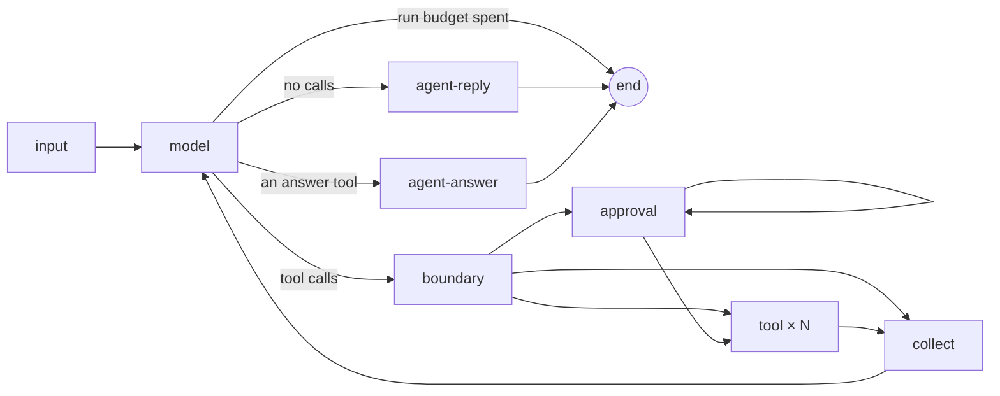

# Agents — the agent's own loop

An `@Agent` runs the framework's **own loop** (#150, `src/graph/agent-loop/`): a compiled LangGraph
subgraph per agent, added to the workflow graph as **one node**, so `describe` and the flow stay
readable. There is no `createAgent` and no LangChain middleware — the loop owns cost accounting,
timeouts, approval and limits. Decision: [ADR-0015](ADR-0015-Own-agent-loop).

## The loop



| Node | Does |
| --- | --- |
| `input` | once per call of the agent: the thread's memory as a message of its own, then the **input message** — its `input` fields from the path's scope, context-mode knowledge, the decisions on its own calls in this execution |
| `model` | one model turn through `ModelGateway.chatModel(…)` with the agent's tools bound; checks the run budget and `modelCalls` before, records usage and checks `toolCalls` after |
| `boundary` | the move joins the conversation; for each call, in order: tool judges → agent judges `beforeToolCall`; a call to a tool the agent does not have is answered `Tool error: there is no tool "…"` |
| `approval` | asks about **one** call that waits (pause seam) and records the decision by `callId` |
| `tool` | one task (`Send`) per allowed call: runs the tool with the run's signal + its `timeout`; stores the result (or `Tool error: …`) under its `callId`; reported costs join the loop's usage |
| `collect` | tool messages in the **call order**, `afterToolCall` (tool, then agent) for calls that ran, decisions recorded; back to `model` |
| `agent-reply` | a text agent's answer: `beforeAgentAnswer`, then the text leaves the loop |
| `agent-answer` | a structured answer through an answer tool: validated by the DTO, `beforeAgentAnswer`, then it leaves the loop as the step's value (`.returns(…)`) |

## The request: static first, then the input message

The model sees, in this order: the **static part** — the agent's instructions (its prompt, rendered
with `promptVariables` only), its tools and answer tools sorted by name, JSON keys sorted — then the
thread's **memory** (finished turns as `start <name>: <input>` / `finish <name>: <output>`, plus
compaction summaries), then the **input message**, then the loop's own turns. The static part is the
same for every run of the agent, so a provider that caches reads it from the cache (Wiki →
[Model providers](Model-providers)). An agent of a recursive workflow whose `oneOf` variant leads to
`ThisWorkflow` has **two** static parts (#264): on the last level (`depth === maxDepth`) that
variant's answer tool is left out ([Workflow as a step → Recursion](Workflow-as-a-step#recursion-264)),
so levels `1 … maxDepth - 1` share one warmed prefix and `maxDepth` has its own — expected, not a
cache miss to chase. The input message has one block per `input` field in
declaration order:

```text
### draft (from editor-agent)
{
  "text": "…"
}

### changes (from reviewer-agent)
{
  "notes": "…"
}
```

An absent `optional` field is `### field` and `none`. A field in the instructions as `{{input.…}}`
fails assembly (`[prompt.input-in-instructions]`) — it would change the static part each run.

## Answers

- An agent **without `output`** is a text agent: its last turn without tool calls is its answer.
  Without `input` it reads the message (`WorkflowStartTextDto`) and may lead only to a
  `WorkflowFinishTextDto` finish (`[flow.text-agent-target]`).
- An agent **with `output`** (`XDto`, `oneOf(ADto, BDto)`, `listOf(…)`) answers through **answer
  tools**, one per variant: `answer-<kebab of the DTO class>` (`answer-offer-draft-dto`), whose
  parameters are the DTO's JSON schema; the variant is the tool's name, never guessed by shape. The
  step ends when the model calls exactly one answer tool and no regular tool in that message.
- Invalid answers go back to the model and spend a retry: arguments that fail the DTO, plain text
  instead of an answer tool, two answer tools or an answer tool mixed with regular tools (none of
  that message's tools runs). After 2 retries the step fails with `AgentAnswerInvalidError`
  (`step.agent.invalid-answer`), which `.onError` can take. A model that cannot call tools fails
  assembly for an agent with `output` (`[model.no-tool-calling]`).

## The move boundary — in this order

the agent's input guardrails in the loop's input node, before the first model call (#120 — on the
masked input message; a resume never checks again) → the move boundary → **approval** → run → the
answer → the agent's judges ([Judges and quality gates](Judges-And-Quality-Gates)) → its output
guardrails as the answer leaves the loop ([Guards](Guards#guardrails)). The `@Guardrail` hooks of tool
calls (`beforeToolCall`, `afterToolCall`, `onChannelDecision`, `beforeAgentAnswer`) are removed
(#120 PR 2); checks of tool calls return as tool-point judges (#123).

## Stored calls, crash and resume

- Every finished call's result is stored in the loop's state under its `callId`, checkpointed node
  by node (`durability: "sync"`); each tool call is its own task, so it is stored as soon as it
  finishes.
- **Nothing finished is repeated**: after a pause, a resume or a restart in a new process the loop
  reads stored results — the model is not asked again for a turn it already made.
- **A call interrupted by a crash may run again** (at-least-once). The tool gets the same
  `executionContext.step.callId` — **side-effecting tools must pass `step.idempotencyKey` (it ends
  with the call id) to the external service**.
- `callId` is the provider's tool call id; when a provider gives none, the loop assigns one unique
  within the run.

## Tool errors are recoverable

An exception, invalid arguments, an invalid result or an unknown tool reach the model as the call's
result (`Tool error: …`); the loop continues.

## Parallel calls

Calls of one model turn that need no approval run **concurrently**; results are handed to the model
in call order. Calls needing approval are asked first, one per pause, in call order.

## Limits per call of the agent

| Limit | Default | Key when hit |
| --- | --- | --- |
| `modelCalls` | 12 | `agents.<name>.limits.modelCalls` |
| `toolCalls` | 20 | `agents.<name>.limits.toolCalls` |

Counted from the flow handing the agent its work to its answer. Until `@Agent({ limits })` (#152),
`toolCalls` comes from `maxToolCalls` (the agent's, then `defaults.tools.maxToolCalls`) when set.
Hitting one **fails** the run with `LimitExceededError`; the loop's spend so far still reaches the
ledger. `agboss describe` shows them: `limits: modelCalls 12 (default) · toolCalls 8`. An exhausted
budget of the execution (#261: its own, its tenant's or the application's) ends the loop before the
next model call with `BudgetExceededError` ([FinOps](FinOps#at-run-time)).

## Approval

A tool declared with a `channel` (`@Tool({ channel: TerminalUserChannel })` or a channel role, found
through the tool — [Tools → Approval channels](Tools#approval-channels)) waits for a decision before
it runs: its channel's `send` decides at once (`ChannelOutcome.decided`), or the call pauses
(`ExecutionOutput.pending`, one entry per waiting call — parallel branches each wait on their own)
and `app.resume({ pauseId, decision })` answers it with a `ToolCallApprovalDecisionDto`
([Pauses](Pauses), [Pause seam](Pause-seam)). Approved → the call runs; rejected → the model reads
`Tool error: the call was rejected by <who answered>[: reason]`.

## Testing

An agent answers by script in a workflow test: `replyWith(text)`, `replyWith(Dto, value)` (a
structured answer, through its answer tool), `callTool(Tool, args)` (args typed by the tool's input
DTO), or a function of the request with `.thenAnswer(...)` ([Testing](Testing)):

<!--
```ts file=support.workflow.ts
import { Agent, Tool, Workflow, WorkflowFinish, WorkflowStart, start, type ToolHandler } from "agboss";
import { Integer, Text, WorkflowFinishTextDto, WorkflowStartTextDto } from "agboss/dto";
class RefundRequest { @Integer({ prompt: "the amount, USD" }) amount!: number; }
class RefundDone { @Text() status!: string; }
@Tool({ name: "refund-tool", description: "Refunds an amount", input: RefundRequest, output: RefundDone })
export class RefundTool implements ToolHandler<RefundRequest, RefundDone> { run(): Promise<RefundDone> { return Promise.resolve({ status: "refunded" }); } }
@WorkflowStart({ name: "chat-workflow-start", description: "A message", input: WorkflowStartTextDto })
export class ChatStart {}
@WorkflowFinish({ name: "chat-workflow-finish", description: "The answer", output: WorkflowFinishTextDto })
export class ChatFinish {}
@Agent({ name: "support-agent", description: "Helps", prompt: "Help the customer.", model: "moonshotai/kimi-k2.6", tools: [RefundTool] })
export class SupportAgent {}
@Workflow({
  name: "support-workflow",
  version: "1.0.0",
  flow: [
    start(ChatStart)
      .returns(WorkflowStartTextDto)
      .toAgent(SupportAgent)
      .toFinish(ChatFinish),
  ],
})
export class SupportWorkflow {}
```
-->

<!-- snippet-context
import { ChatFinish, ChatStart, RefundTool, SupportAgent, SupportWorkflow } from "./support.workflow.js";
-->

```ts
import { expect } from "vitest";
import { callTool, replyWith, testWith } from "agboss/testing";
import { Application, EmptyEnvironment } from "agboss";

@Application({ name: "support-application", version: "1.0.0", environment: EmptyEnvironment, workflows: [SupportWorkflow] })
class SupportApplication {}

const test = testWith(SupportApplication); // an application, never the workflow itself

test("a refund request calls the refund tool, then answers", async ({ app, mockLlm }) => {
  mockLlm(SupportAgent).thenAnswer((request) =>
    request.kind === "chat" && request.messages.some((line) => line.role === "tool")
      ? replyWith("Refunded.")
      : callTool(RefundTool, { amount: 100 }),
  );

  const result = await app.execute(ChatStart, { text: "refund me 100" });

  expect(mockLlm(SupportAgent)).toHaveCalledTools([RefundTool]);
  expect(result).toFinishWith(ChatFinish, { text: "Refunded." });
});
```
