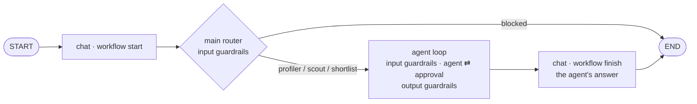

# Architecture

The framework lives in `packages/agboss/` (paths below are relative to it); the example in
`examples/job-scout/` ([Example](Example)). ADR: [0011](ADR-0011-graphInject-framework-package-and-examples-apart).

The workflow file **is** the graph ([Workflow](Workflow), [ADR-0019](ADR-0019-Flow-as-paths-with-path-scope)):
paths through `@WorkflowStart`, `@Router`, `@Agent`, `@Action` and `@WorkflowFinish` classes, checked at assembly
(and typed by the generated `.agboss/types.d.ts`) and run as one LangGraph `StateGraph` per workflow, its
node ids the components' names, the path's scope a channel of its own. job-scout is one path per turn:

- **workflow start** — where a run starts (`@WorkflowStart`); its validated input is its value.
- **guardrails** — at the model boundary of each agent and model router (#120): input guardrails on
  what its model reads (masked), before the call; output guardrails on an agent's answer. A block
  fails the run with `GuardrailBlockedError` and its refusal. See [Guards](Guards#guardrails).
- **router** — a `@Router` node: asks its own model (Jev or a chat model, see [Routers](Routers)) to
  pick one of its routes from its input; a failed call or an unknown option **fails** the run
  (unless an `.onError` takes it).
- **agent** — the agent's own loop as a compiled subgraph (#150): model turns, the move boundary
  (approval — one call per pause; judges on the reply), tool calls as parallel tasks stored by `callId`;
  usage recorded per call, the run budget checked before each call, `modelCalls` / `toolCalls`
  limits fail the run. See [Agents](Agents), [Tools](Tools), [Pause seam](Pause-seam).
- **action** — an `@Action`: code without a model, its fields from the path's scope.
- **workflow finish** — where a run finishes (`@WorkflowFinish`): its output — the latest value of its output type
  on the path, or what its `finish(input)` builds.
- **limits** — steps (`maxSteps`), visits (`maxVisits`), spend per run and per day, checked before each working node;
  hitting one **fails** the run (`LimitExceededError`) unless an `.onError` takes it. See [Workflow](Workflow), [FinOps](FinOps).
- **application** (`@Application`, `createApp(App)` → `execute` / `resume` / `cancel` / `close` over every workflow of it, [App](App)) over the run layer
  (`src/run`: `executeAgent` / `resumeAgent`) — check the
  daily cap before the graph starts, record spend as it happens, write a Tern for every outcome
  (answered, paused, failed).

## Modules and dependency rules

| Module               | Responsibility                                             | May depend on                                    |
| -------------------- | ---------------------------------------------------------- | ------------------------------------------------ |
| `src/config`         | config schema, types, defaults resolution                  | —                                                |
| `src/finops`         | usage records, cost report, daily ledger                   | config, llm (types)                              |
| `src/llm`            | OpenRouter chat factory, Jev client, cache, registry       | config                                           |
| `src/routers`        | routing strategies (Jev, LLM)                              | config, finops, llm — **only**                   |
| `src/tools`          | typed tools, registry, MCP facades, LangChain adapter      | config, finops, llm — **only**                   |
| `src/terns`          | run records, threads, scores (SQLite)                      | nothing in `src` — **isolated**                  |
| `src/guardrails`     | `@InputGuardrail` / `@OutputGuardrail`: levels, rules, run | components, flow, llm, finops                    |
| `src/pause`          | pause seam types and policy                                | tools (types)                                    |
| `src/prompts`        | agent, agent-loop, routing, guardrail texts                | config                                           |
| `src/tracing`        | optional run tracing (Langfuse)                            | —                                                |
| `src/graph`          | flow DSL, rules, decorators, engine, nodes, limits         | everything above; routers via `routers/index.ts` |
| `src/run`            | executeAgent / resumeAgent: threads, Terns                     | graph, finops, terns, prompts, routers, tracing  |
| `src/eval`           | Jev judge, eval, replay                                    | run, routers, terns, finops                      |
| `src/workflow.ts`    | workflow (flow + limits + config + prompts + tools + MCP)  | config, graph, prompts, tools, routers (types)   |
| `src/application`, `src/app` | `@Application`, `createApp`, one workflow's wiring (`createAppDeps`) | all of the above              |
| `src/testing`        | `@agboss/core/testing`: testWith, scripted models, matchers | app, graph, llm (gateway), tools — tests only   |
| `src/internal.ts`    | `@agboss/core/internal`: what the CLI is built on (not public) | app, loader, describe, eval                  |
| `packages/agboss-cli` | the `agboss` command — a separate package            | `agboss` (+ `/internal`)                   |
| `examples/job-scout` | the example — a separate package using only `agboss` | `agboss` (+ `/dto`, `/units`, `/models`, `/mcp`, `/rag`) |

Router, tool and Tern isolation rules are enforced by ESLint (`no-restricted-imports`); the rest of
`src` imports them only via their `index.ts`.
