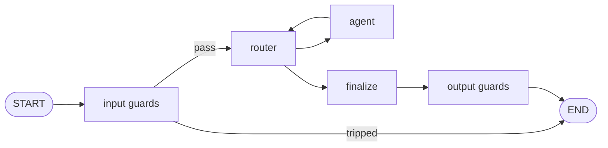

# Guards

Safety checks before and after the agents. A guard is a **router with two options** — `flag` /
`pass` — plus a threshold on P(flag). Same machinery as routers: Jev by default, any guard can set its
own model, every call is billed.



## Configure

<!-- snippet-context
import { Agent, Workflow, WorkflowFinish, WorkflowSettings, WorkflowStart, start, type WorkflowDefinition } from "agboss";
import { WorkflowFinishTextDto, WorkflowStartTextDto } from "agboss/dto";
@WorkflowStart({ name: "support-workflow-start", description: "A message", input: WorkflowStartTextDto })
export class ChatWorkflowStart {}
@Agent({ name: "support-agent", description: "Answers", prompt: "Answer the message.", model: "moonshotai/kimi-k2.6" })
export class SupportAgent {}
@WorkflowFinish({ name: "support-workflow-finish", description: "The answer", output: WorkflowFinishTextDto })
export class ChatWorkflowFinish {}
-->

```ts
@Workflow({
  name: "support-workflow",
  version: "1.0.0",
  flow: [
    start(ChatWorkflowStart)
      .returns(WorkflowStartTextDto)
      .toAgent(SupportAgent)
      .toFinish(ChatWorkflowFinish),
  ],
  defaults: {
    models: { temperature: 0 },
    guardrail: { model: "typesafe/jev-1.13" }, // the guards' model unless one sets its own (#261)
    history: { limit: 5 },
  },
  guards: {
    input: { prompt_injection: { threshold: 0.7, refusal: "I can't help with that request." } },
    output: {
      pii: { threshold: 0.7, refusal: "The answer contained personal data and was withheld." },
    },
  },
})
export class Support implements WorkflowDefinition {
  settings() {
    return WorkflowSettings.builder()
      .build();
  }
}
```

The question each guard asks and what `flag` / `pass` mean are the framework's texts
(`prompt_injection`, `pii`); a guard name without texts stops startup (`MissingGuardPromptError`).

## Behaviour

| Situation                                     | Result                                                                                                 |
| ---------------------------------------------- | -------------------------------------------------------------------------------------------------------- |
| input guard trips                             | no router or agent call; answer = its refusal; `stop: stopped by guard: <name>`; Tern status `guarded` |
| output guard trips                            | the agents' answer is replaced by the refusal; same stop reason and status                             |
| P(flag) < threshold                           | content passes                                                                                         |
| a guard cannot routeTo (API error, bad output) | **fails closed**: `GuardFailedError`, its spend still in the ledger                                    |

Guards of one side run in order; the first that trips stops. Cost appears as
`router:guard:<name>` in the report. Guard texts are part of the prompt version of a Tern.

## Guardrails — your own checks around tools and answers

Code checks are `@Guardrail` classes (created by the container with their `deps`) attached to the
workflow (`@Workflow({ guardrails })`), an agent or a tool (`guardrails`, `overrideGuardrails`,
`disableGuardrails`). Their hooks run at the agent loop's boundary ([Agents](Agents)):
`beforeToolCall` (may override the arguments), `afterToolCall`, `onChannelDecision`,
`beforeAgentAnswer`; a hook that throws stops the move.

<!-- snippet-context
type GuardrailContext = Parameters<NonNullable<Guardrail["beforeAgentAnswer"]>>[0];
-->

```ts
import { Guardrail } from "agboss";

@Guardrail({ name: "no-card-numbers" })
export class NoCardNumbers implements Guardrail {
  beforeAgentAnswer(ctx: GuardrailContext): Promise<void> {
    if (/\b\d{4}( ?\d{4}){3}\b/.test(ctx.replyWith ?? ""))
      return Promise.reject(new Error(`${ctx.agent} tried to answer with a card number`));
    return Promise.resolve();
  }
}
```

PII masking is the same kind of component: `@PiiPolicy` classes implementing `mask(text)` and
`maskJson(value)`, attached with `piiPolicies`.
