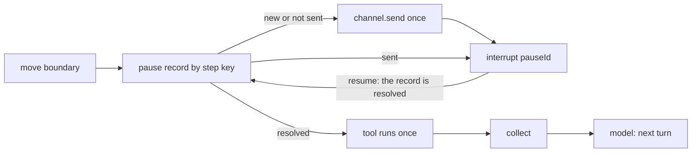

# Pause seam

A run ends at a workflow finish and the next question is a new run in the same thread — unless a
tool needs a decision first. Then the call **pauses**: `app.execute` returns `status:
ExecutionStatus.Paused` with every waiting call in `pending`, and `app.resume({ pauseId, decision })`
answers one of them ([Pauses](Pauses): several pauses at once, who answers, concurrent answers). This
page is how a pause works inside: the core defines where and how, so a pause never contradicts
limits, spend recording or Terns.

## Plug it in

A tool that needs approval names a **channel** — who is asked — found through the tool, nothing to
list in the workflow (#267): a concrete `@Channel` used as is (`TerminalUserChannel` asks in the
terminal; `AutoApproveChannel` / `AutoRejectChannel` decide at once, for tests and scripts) or a
**channel role** whose implementation the application lists
([Tools → Approval channels](Tools#approval-channels)):

<!-- snippet-context
import { Agent, ExecutionStatus, TerminalUserChannel, Tool, Workflow, WorkflowFinish, WorkflowStart, start, type ToolHandler } from "@agboss/core";
import { Email, Text, WorkflowFinishTextDto, WorkflowStartTextDto } from "@agboss/core/dto";
class EmailDraft { @Email() to!: string; @Text() body!: string; }
class EmailSent { @Text() id!: string; }
@WorkflowStart({ name: "task-workflow-start", description: "A task", input: WorkflowStartTextDto })
export class TaskStart {}
@WorkflowFinish({ name: "done-workflow-finish", description: "Done", output: WorkflowFinishTextDto })
export class Done {}
-->

```ts file=errands.workflow.ts
@Tool({
  name: "send-email-tool",
  description: "Sends an email",
  input: EmailDraft,
  output: EmailSent,
  channel: TerminalUserChannel, // the call waits for a decision
})
export class SendEmail implements ToolHandler<EmailDraft, EmailSent> {
  run(draft: EmailDraft): Promise<EmailSent> {
    return Promise.resolve({ id: `sent to ${draft.to}` });
  }
}

@Agent({ name: "assistant-agent", description: "Does errands", prompt: "Do the errand.", model: "moonshotai/kimi-k2.6", tools: [SendEmail] })
export class Assistant {}

@Workflow({
  name: "errands-workflow",
  version: "1.0.0",
  flow: [
    start(TaskStart)
      .returns(WorkflowStartTextDto)
      .toAgent(Assistant)
      .toFinish(Done),
  ],
})
export class Errands {}
```

<!-- snippet-context
import { Application, ExecutionStatus, createApp } from "@agboss/core";
import { Errands, TaskStart } from "./errands.workflow.js";
-->

```ts
import { EmptyEnvironment } from "@agboss/core";
@Application({ name: "errands-application", version: "1.0.0", environment: EmptyEnvironment, workflows: [Errands] })
class ErrandsApplication {}

const app = await createApp(ErrandsApplication);
const first = await app.execute(TaskStart, { text: "Email the report to my boss" });
const [waiting] = first.pending; // { pauseId, answeredBy, agent, channel, ask: { tool, arguments, … } }
if (first.status === ExecutionStatus.Paused && waiting?.pauseId !== undefined) {
  // TerminalUserChannel's pauses are answered by the thread's owner: their id is listed
  const done = await app.resume({ pauseId: waiting.pauseId, decision: { approved: true } });
  console.log(done.output);
}
```

The decision is a `ToolCallApprovalDecisionDto` (`@agboss/core/dto`): `approved`, `reason?` — why,
`overrideArguments?` — only with `approved: true`, checked by the tool's input. Who answered is not
part of it: the framework knows it from the resume (`answeredBy`, or the thread's owner). It is
validated before it is recorded (`DtoValidationError` otherwise; the pause keeps waiting). `agboss
chat` asks in the terminal; a decline carries `reason: "declined in the terminal"`. `sensitive`
fields of the input DTO are shown masked.

A tool no longer pauses **to ask a question** itself: `ctx.pause(question)` went with `ctx` (#280).
Workflow questions — a `WorkflowPauseQuestionDto` asked of a person, the answer resuming the
execution — are not built yet: a question role (`ask` / `answer`) cannot be declared (#647), and
asking one from a step or a tool is #659.

Paused runs and their pauses live in the application's `PausedExecutionRepository` and their state
in its `BaseCheckpointSaver` (#261) — in memory by default, lost on restart. A pause survives a
restart when both are durable: a class that `extends PausedExecutionRepository` and a durable
`BaseCheckpointSaver` listed in `@Application({ providers })` (`SqlitePausedExecutionRepository` and
`SqliteCheckpointSaver`, #265).

## How it works



1. Inside the agent's loop ([Agents](Agents)) a call whose tool needs approval is **not executed**:
   after the move boundary the loop's `approval` node runs the **pause step** (#267
   S35) in the call's frame. It records the pause by the step's idempotency key
   (`step.idempotencyKey`, the call's id in it) — `findOrCreateByStepKey`: a new record gets a
   random 128-bit `pauseId`, `Pending`, not sent.
2. **Send once**: a record not yet sent asks the channel — `send({ pauseId, value })`, `value` the
   call (`ToolCallApprovalAskDto`, `sensitive` fields masked). `ChannelOutcome.decided(decision)`
   closes the record at once (`Taken`, `PauseResolution.Decided`, kept for the audit trail and its
   retention) and the step goes on with that decision, validated like a reply.
   `ChannelOutcome.awaitReply()` marks the record sent — only while it is still `Pending`, so a
   reply that resolved it while `send` was returning is never overwritten and is taken at once —
   and the step stops at LangGraph's `interrupt({ pauseId })`: the run is **paused**, not finished.
   The loop is a compiled subgraph inside the agent's flow node, so everything before the pause is
   checkpointed and never repeated; the spend so far is read from the loop's checkpoint and
   written to the ledger at the pause — of every loop still waiting at an open pause, summed (each
   branch's own spend once; a branch that took its decision in this pass is the flow's now). A crash between the record and `send` asks again on the
   next try, with the same `pauseId`.
3. **A re-entry asks nothing**: a resume of a sibling pause runs every interrupted step again; a
   step whose record is sent and still `Pending` goes straight back to `interrupt()` (no second
   `send`, no `onExecutionPause` of its own); one `Resolved` takes its decision; one `Cancelled`
   (withdrawn) stops its branch, which ends `Cancelled`.
4. **The resume**: one `Command({ resume })` for the whole tree maps LangGraph's interrupt id of
   every pause with an answer (resolved or withdrawn); the pauses without one stop at their
   `interrupt()` again. A pass that took a decision marks its pause `Taken`. A resumed call: approved
   → the tool runs **once**; rejected → the model reads `Tool error: the call was rejected by <who
   answered>[: <reason>]`. The model is **not** asked again for the turn that asked for the call — it
   continues with the results.
5. **One call per pause**: two calls needing approval in one model turn → two pauses, in call order.

## Rules that keep the core consistent

| #   | Rule                                                                                      |
| --- | -------------------------------------------------------------------------------------------- |
| 1   | Spend before the pause is already in the ledger; on resume nothing is recorded twice      |
| 2   | The run budget left at the pause is checkpointed and carried over                         |
| 3   | The Tern is written with status `paused` and completed (same id) on resume                |
| 4   | Guardrails, limits, agent limits, history apply to the paused-and-resumed run as one run  |
| 5   | A rejection reaches the model as a tool error                                             |

After the decision and the agent's answer the router sends the turn to its workflow finish without a
model call (#100). Answering a pause no longer waiting (twice, after it was withdrawn) →
`NotPausedError`. A failure after resume completes
the same Tern as `failed`. Decision recorded in [ADR-0004](ADR-0004-Pause-seam).

## After the decision

The loop goes on after the decision: the model reads the call's result (or the rejection) and
answers. **Then the turn ends** — the router is not asked again
(`stop: the agent answered after the approval decision`); a follow-up goes to the next turn (#100).
