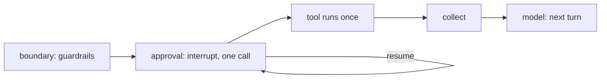

# Pause seam

A run ends at a workflow finish and the next question is a new run in the same thread — unless a
tool needs a decision first. Then the run **pauses**: `app.execute` returns `status: ExecutionStatus.Paused` with
the waiting call in `pause`, and `app.resume(thread, decision)` continues it. The core defines where
and how, so a pause never contradicts limits, spend recording or Terns.

## Plug it in

A tool that needs approval names a **channel** — who is asked — and the workflow lists the channel
classes it uses (`TerminalUserChannel` asks in the terminal; `AutoApproveChannel` /
`AutoRejectChannel` for tests and scripts; or your own `@Channel` class):

<!-- snippet-context
import { Agent, ExecutionStatus, TerminalUserChannel, Tool, Workflow, WorkflowFinish, WorkflowStart, start, type ToolHandler } from "agboss";
import { Email, Text, WorkflowFinishTextDto, WorkflowStartTextDto } from "agboss/dto";
class EmailDraft { @Email() to!: string; @Text() body!: string; }
class EmailSent { @Text() id!: string; }
@WorkflowStart({ name: "task-workflow-start", description: "A task", input: WorkflowStartTextDto })
export class TaskStart {}
@WorkflowFinish({ name: "done-workflow-finish", description: "Done", output: WorkflowFinishTextDto })
export class Done {}
-->

```ts file=errands.workflow.ts
@Tool({
  name: "send_email",
  description: "Sends an email",
  input: EmailDraft,
  output: EmailSent,
  channel: TerminalUserChannel, // the call waits for a decision
})
export class SendEmail implements ToolHandler<EmailDraft, EmailSent> {
  run(draft: EmailDraft): Promise<EmailSent> {
    return Promise.resolve({ id: `sent to ${draft.to}` });
  }
}

@Agent({ name: "assistant-agent", description: "Does errands", prompt: "Do the errand.", model: "moonshotai/kimi-k2.6", tools: [SendEmail] })
export class Assistant {}

@Workflow({
  name: "errands-workflow",
  version: "1.0.0",
  flow: [
    start(TaskStart)
      .returns(WorkflowStartTextDto)
      .toAgent(Assistant)
      .toFinish(Done),
  ],
  channelClasses: [TerminalUserChannel], // a tool's channel missing here fails assembly
})
export class Errands {}
```

<!-- snippet-context
import { Application, ExecutionStatus, createApp } from "agboss";
import { Errands, TaskStart } from "./errands.workflow.js";
-->

```ts
@Application({ name: "errands-application", version: "1.0.0", workflows: [Errands] })
class ErrandsApplication {}

const app = await createApp(ErrandsApplication);
const first = await app.execute(TaskStart, { text: "Email the report to my boss" });
if (first.status === ExecutionStatus.Paused) {
  // first.pause = { agent, callId, tool: "send_email", args: { to: "…", body: "…" } } → ask someone
  const done = await app.resume(first.thread, { approved: true, by: "pavel" });
  console.log(done.output);
}
```

The decision is a `ToolCallApprovalDecisionDto` (`agboss/dto`): `approved`, `by` — who or what
decided, `feedback?` — why, `overrideArguments?`. It is validated on resume (`DtoValidationError`
otherwise). `agboss chat` asks in the terminal and fills `by` with the OS user name; a decline carries
`feedback: "declined in the terminal"`. `sensitive` fields of the input DTO are shown as `***`.

A tool no longer pauses **to ask a question** itself: `ctx.pause(question)` went with `ctx` (#280).
Workflow questions — a `WorkflowPauseQuestionDto` asked of a person, the answer resuming the
execution — come back as their own steps with channel roles (#267).

Paused runs live in the application's `PausedExecutionRepository` and their state in its
`BaseCheckpointSaver` (#261) — in memory by default, lost on restart. A pause survives a restart
when both are durable: a class that `extends PausedExecutionRepository` and a durable
`BaseCheckpointSaver` listed in `@Application({ providers })` (the SQLite ones come with #265).

## How it works



1. Inside the agent's loop ([Agents](Agents)) a call whose tool needs approval is **not executed**:
   after the `beforeToolCall` guardrails, the loop's `approval` node calls LangGraph
   `interrupt({ agent, callId, tool, args })` — the run is **paused**, not finished. The loop is a
   compiled subgraph inside the agent's flow node, so everything before the pause is checkpointed
   and never repeated; the spend so far is read from the loop's checkpoint and written to the
   ledger at the pause.
2. **One call per pause**: two calls needing approval in one model turn → two pauses, in call order.
3. `app.resume(thread, decision)` continues the same step: approved → the tool runs **once**;
   rejected → the model reads `Tool error: the call was rejected by <by>[: <feedback>]`. The model is
   **not** asked again for the turn that asked for the call — it continues with the results.

## Rules that keep the core consistent

| #   | Rule                                                                                      |
| --- | -------------------------------------------------------------------------------------------- |
| 1   | Spend before the pause is already in the ledger; on resume nothing is recorded twice      |
| 2   | The run budget left at the pause is checkpointed and carried over                         |
| 3   | The Tern is written with status `paused` and completed (same id) on resume                |
| 4   | Guards, limits, agent limits, history apply to the paused-and-resumed run as one run      |
| 5   | A rejection reaches the model as a tool error                                             |

After the decision and the agent's answer the router sends the turn to its workflow finish without a
model call (#100). Resuming a run that is not paused (or twice) → `NotPausedError`. A failure after resume completes
the same Tern as `failed`. Decision recorded in [ADR-0004](ADR-0004-Pause-seam).

## After the decision

The loop goes on after the decision: the model reads the call's result (or the rejection) and
answers. **Then the turn ends** — the router is not asked again
(`stop: the agent answered after the approval decision`); a follow-up goes to the next turn (#100).
